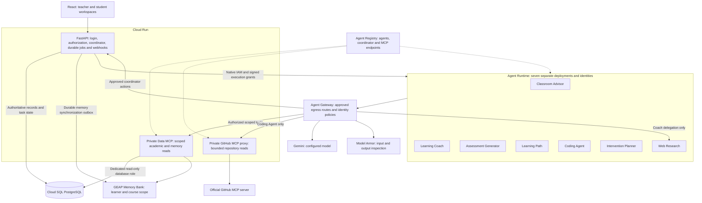
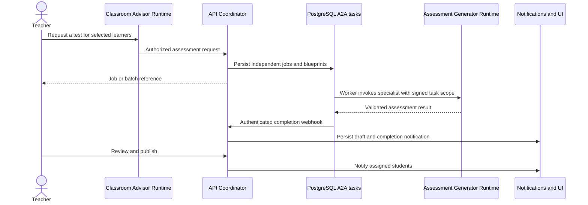
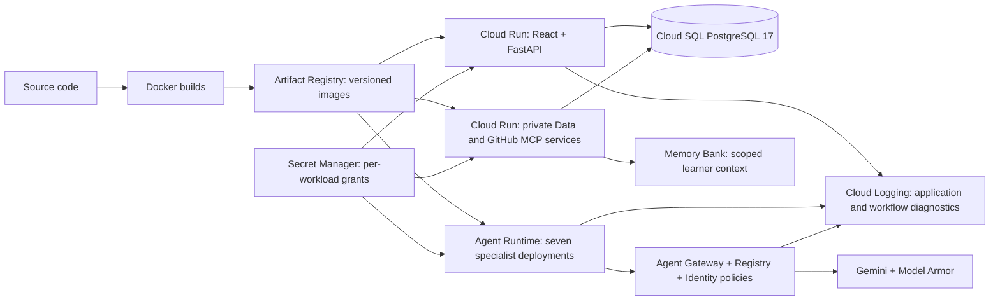

# OpenClass AI

OpenClass connects classroom evidence, personalized learning and teacher-controlled assessments. Built with **React, FastAPI, PostgreSQL, Google ADK and Gemini**, it uses **Gemini Enterprise Agent Platform (GEAP)** for specialist hosting, workload identities, managed memory and governed agent access.

Built for **Google AI Builder Cup 2026** by **Team OpenClass**. Team leader: **Vinay Babu U**. Members: **Vinay and Ansuman**.

## Try the live application

**Application: [Open OpenClass](https://openclass-jdi6nfaqza-uc.a.run.app)**

Use the teacher or student demo credentials provided separately by the team. The hosted demo contains synthetic classroom records.

The classroom is **Machine Learning: from data to decisions (ML 201)**: ten learners with different strengths, evidence gaps and feedback, twenty syllabus topics, and fourteen topics taught (**70% teaching coverage**). Teaching coverage and student mastery are separate measures. See [Machine Learning demo data](mock_data/MACHINE_LEARNING.md).

**Deployment verified on 18 October 2026:** the public frontend returns HTTP 200; teacher and student login, workspace, notifications and logout pass through the public URL. Seven specialist agents are serving on Agent Runtime. Cloud Run hosts the web/API application and two private MCP services.

## Suggested demo walkthrough

1. Sign in as teacher and explore **Analytics**, **Learners**, curriculum coverage and a student's detailed profile. Missing evidence calls for a diagnostic; it is not a zero score.
2. Ask **Classroom Advisor** about learning gaps, then request an assessment for a selected learner. The Advisor delegates generation to the Assessment Generator. Review and publish the resulting draft.
3. Sign in as that student, open the notification, complete the assessment and inspect the saved result and updated learning evidence.
4. Ask **Learning Coach** to explain a concept or generate a private practice test. Follow **Open private test** to complete it. Start another conversation with **+ New session**.
5. As teacher, open **AI learning plans** to generate or regenerate a learner's detailed plan. Plans include lessons, exercises, checkpoints and approved reference links.
6. Explore **Coding assignments** and submit a public GitHub repository for a provisional source-based review. Teachers can also explore **Digital Twin** to compare current evidence with hypothetical future assessment scores.

Generation runs asynchronously where appropriate. Many requests complete within tens of seconds; web research has taken about 90 seconds in live checks. Chat shows processing stages before the final response. This is progress streaming, rather than token-by-token answer streaming.

See the [recording walkthrough](deployment/demo-recording.md). The submission presentation is maintained separately and excluded from the shared code repository. Prototype screenshots and submission video links can be added separately.

## Deployed architecture



The application and managed services are deployed in Google Cloud. Project identifiers, database connection details and credentials are maintained in private deployment configuration.

The public application is the entry point. Specialist invocation and MCP services remain protected. Agent Gateway governs attached Runtime egress; MCP servers run as separate Cloud Run services and are registered as destinations. The initial API-to-Runtime invocation uses native IAM, with signed execution grants providing additional application authorization.

PostgreSQL is authoritative for accounts, enrollment, curriculum, assignments, submissions, assessments, grades, evidence, Learning Twins, conversations, notifications and durable tasks. Memory Bank supplies long-term learner context; it does not replace academic records or determine grades.

## Agents and their responsibilities

Each specialist has a separate folder under [`backend/agents/`](backend/agents/), with `agent.py` for instructions/schema and `workflow.py` for its dynamic workflow. Shared execution and validation live in [`runner.py`](backend/agents/runner.py) and [`workflow.py`](backend/agents/workflow.py).

| Agent | Responsibility | Trigger and communication |
| --- | --- | --- |
| **Classroom Advisor** | Explains class and learner performance; requests assessments | Teacher chat; scoped academic/memory tools and authorized coordinator actions |
| **Learning Coach** | Explains concepts, summarizes personal progress and suggests next steps | Student chat; private progress/memory tools; delegates private tests and public research |
| **Assessment Generator** | Generates questions against a validated concept/recipient blueprint | Teacher assessment jobs or student private-practice jobs; results validated before persistence |
| **Learning Path** | Produces detailed study steps, lessons, practice, checkpoints and references | Student self-study requests or teacher regeneration for one, selected or all learners |
| **Coding Agent** | Reviews bounded repository source and returns skills, gaps, references and a provisional rating | Repository submission; private GitHub MCP access; no submitted-code execution |
| **Intervention Planner** | Proposes focused support and reassessment criteria | Teacher request from learner evidence; draft requires teacher approval |
| **Web Research** | Answers public educational questions with search-backed sources | Learning Coach delegation; receives a public question without private learner records |

The **Coordinator** in [`backend/agents/coordinator/`](backend/agents/coordinator/) is deterministic Python, not an eighth LLM agent. It authorizes recipients, prepares assessment blueprints, persists jobs and controls dispatch. Dynamic workflows provide conditional routing and deterministic input/output gates. Durable queues, leases and bounded workers provide concurrency and recovery.

### How agents communicate



The application assessment task interface uses an **A2A 0.3 JSON-RPC HTTP profile** with authenticated webhook completion. The durable dispatcher and callback handling run in FastAPI; specialist model execution runs remotely through Runtime's HTTP invocation interface. Not every remote invocation is an A2A exchange.

For ten learners, the coordinator creates ten independent jobs. Workers process them with bounded concurrency (three generators by default); remaining jobs queue. **Same concepts / different questions** keeps the selected concepts aligned while generating separate question variants. Generation does not publish tests automatically. See [A2A workflows and batch variants](docs/a2a-workflows.md).

Learning Coach can request a private assessment and return an **Open private test** action. Student self-study questions and results remain private through application authorization and are separate from teacher assessments. Coach delegates public educational research to Web Research; private academic records must not enter search queries.

## How OpenClass uses GEAP

| Service | Purpose and deployed status |
| --- | --- |
| **Agent Runtime** | Hosts all seven serving specialists independently of the web/API application |
| **Agent Identity** | Distinct native workload identities; exact caller allowlists, signed scopes and resource-specific invocation grants |
| **Agent Registry** | Registers seven agents, the coordinator endpoint and both MCP servers/tool specifications |
| **Agent Gateway** | Attached to all seven runtimes; five applied access policies contain 49 exact-identity route rules, including two exact coordinator HTTP routes |
| **Memory Bank** | Scoped learner/course context retrieved by authorized tools; live Coach retrieval returned available |
| **Model Armor** | Configured fail-closed input/output inspection for prompt injection, jailbreak and other configured threats; exact workload grants permit sanitization |

Protected Web Research completed successfully after Gateway attachment, with Gateway logs showing allowed traffic and TLS interception. Earlier live checks also verified the other six agent flows. A complete repeat of every agent/tool path after all seven Gateway attachments, and a controlled negative Gateway enforcement test, remain follow-up checks. Attachment alone is not proof of every policy decision.

See the [managed deployment guide](deployment/managed/README.md), [verification record](deployment/managed/verification.md) and [communication policy](security/agent-policy.json).

## Learning evidence, sessions and notifications

- **Learning Twins:** per-course evidence summaries and history. Hypothetical teacher simulations do not modify learner evidence. Chat and repository reports do not automatically prove mastery.
- **Coach conversations:** students share specialist code but have separate server-derived conversation/session identities. New threads retain authorized access to the student's academic records and scoped long-term memory.
- **Learning paths:** versioned plans can be refreshed from feedback. Teachers can regenerate one, selected or all learners' plans. Paths older than 24 hours are marked due; daily scheduling is currently manual.
- **Student plan navigation:** **AI learning plans** displays the student's generated paths, including teacher-requested updates. **Assigned support plans** contains the separate teacher-approved interventions. **Agents & Sessions** and **Services & Setup** are removed from both roles' navigation.
- **Notifications:** persisted, recipient-scoped updates for assigned tests, assessment completion, coding reports, plans and relevant evidence events. The UI shows unread counts and popups while open.
- **Teacher controls:** generated drafts require review and publication/assignment where applicable. Coding ratings are provisional, not automatic final grades.

Details: [student data models](docs/student-data-model.md), [assignment persistence](docs/assignment-data-model.md), [Coach conversations and progress events](docs/coach-conversations.md), [private practice and learning paths](docs/private-self-study.md).

## Mock data

[`mock_data/`](mock_data/README.md) contains the default ten-student Machine Learning demo and an optional legacy fixture pack. Learners have different evidence coverage, strengths, feedback and starter plans. Planned topics are marked not yet taught rather than scored as gaps.

The default fixtures include three quizzes with graded attempts, two coding assignments, sample provisional reports, ten detailed starter paths, feedback and Twin history. These are **synthetic examples**, not measured educational outcomes or live Gemini outputs. Live generation creates separate records.

```powershell
# Validate the fixture pack
uv run python -m mock_data.validate
# Preview import; use --apply to insert missing synthetic records
uv run python -m mock_data.seed
uv run python -m mock_data.seed --apply
```

Demo startup imports the dataset once using an import marker. Fixture import does not call Gemini or Memory Bank and does not overwrite existing non-synthetic work. The older forty-learner pack is opt-in with `--legacy`. See [dataset details](mock_data/MACHINE_LEARNING.md).

## Run locally: Windows / PowerShell

Prerequisites: Docker Desktop with Linux containers, Node.js 22, `uv`, Python 3.12 and Google Application Default Credentials for Cloud SQL/cloud integrations.

For first-time setup, copy `.env.example` to `.env` **only if `.env` does not already exist**. Set `GEMINI_API_KEY`; do not put keys in frontend code. Keep the existing Cloud SQL and Memory Bank configuration. `GEMINI_MODEL` defaults to `gemini-3.8-flash`.

```powershell
uv sync --extra cloud --python 3.12
gcloud auth application-default login
gcloud auth application-default set-quota-project YOUR_PROJECT_ID
docker compose --profile cloud up -d cloud-sql-proxy
uv run uvicorn backend.main:app --reload
```

In a second terminal:

```powershell
cd frontend
npm.cmd install
npm.cmd run dev
```

Open **http://localhost:5173**; local API docs: **http://localhost:8000/docs**. The proxy listens on localhost:5433; keep it running. `scripts/start.ps1` is the local setup helper, with `-SkipInstall` to skip installation. See [Cloud SQL setup](deployment/cloud-postgres.md) for connectivity and the optional separate local PostgreSQL profile.

## Deployment and application updates

The deployed application uses versioned Artifact Registry images, Cloud Run for the web/API and private MCP services, Agent Runtime for the seven specialists, Secret Manager for credentials and Cloud SQL for persistence. CI/CD is not configured.

A small visual change typically takes about **10–20 minutes** for editing, building, deployment and smoke verification; this is an estimate, not a deployment guarantee. The updated revision serves the same application URL once traffic switches. A browser refresh may be needed. Pure frontend changes require the web image to be rebuilt, but do not require redeploying agents or the database. Local Vite development shows most UI edits immediately through hot reload.

For an application change:

1. Edit the relevant frontend/backend/specialist module and run the appropriate checks locally.
2. Build a versioned image using the managed deployment scripts. Frontend changes require a new web image; specialist changes require a runtime image and serving updates for affected agents.
3. Review a Terraform plan and apply only the intended release changes, preserving workload identities, Gateway policies and existing data. Do not enable bootstrap mode on the live release.
4. Verify login, workspace, affected agent/tool calls, persistence, notifications and callback completion. Retain the prior image/revision for rollback.

See [managed deployment instructions](deployment/managed/README.md). The database is a small zonal hackathon instance; high availability, production capacity and restore drills need separate preparation.

## Verification

Latest recorded checks:

| Check | Result |
| --- | --- |
| Full Python suite against disposable PostgreSQL | **92 passed, zero skipped** |
| Targeted security/runtime checks | **18 passed** |
| Public frontend and both role login/workspace/notification/logout flows | Passed |
| Coach and Advisor real Gemini responses with saved history | Passed |
| Assessment generation, authenticated callback, saved draft and notification | Passed |
| Publication, hidden answer key before submission, grading and saved attempt | Passed |
| Student private test generation and teacher access denial | Passed; teacher request returned 403 |
| Detailed learning path and intervention generation | Passed |
| Coding review through deployed private GitHub MCP | Passed; appropriately provisional/low confidence for the sample repository |
| Web Research through attached Gateway | Passed; four source links returned |

These are functional acceptance checks, not a quality, fairness, load or educational-effectiveness benchmark. Ten-learner batch completion is not claimed by this table. See [verification details](deployment/managed/verification.md).

```powershell
# Public application smoke check; optional --chat invokes Gemini
uv run --no-sync python deployment/managed/check-application.py --url https://openclass-jdi6nfaqza-uc.a.run.app
# Frontend production build
cd frontend
npm.cmd run build
```

Integration tests reset their target database. Use a dedicated disposable test database; **never use the application Cloud SQL database**. See [agent quality evaluations](evals/README.md) for the separate behavior-review workflow.

## Code map

### GCP deployment topology



Images and infrastructure are deployed manually through the scripts and Terraform in `deployment/managed/`; there is no CI/CD pipeline. Deployment configuration is separate from source code. Existing databases, memory resources and native agent identities are preserved during application updates.

```text
backend/
  main.py                 FastAPI application and lifecycle
  routes/                 Role-scoped classroom, assessment and intelligence APIs
  agents/
    classroom_advisor/    Teacher performance reasoning and delegation
    learning_coach/       Student tutoring, progress and private-study actions
    assessment_generator/ Assessment specialist
    learning_path/        Detailed learning-path specialist
    coding_agent/         Bounded static repository assessment
    intervention_planner/ Teacher support-plan specialist
    web_research/         Public educational research specialist
    coordinator/          Deterministic authorized task creation
    runner.py             Model execution, shared runtime/tool routing
    workflow.py           Dynamic routing and deterministic checks
  runtime/                Managed specialist entry point and invocation client
  a2a/                    Durable tasks, leases, dispatch and callbacks
  cloud/                  Memory, outbox, Model Armor and MCP clients
  security/               Workload verification and scope/policy checks
  store.py                PostgreSQL persistence and startup initialization
  learning.py             Evidence aggregation and deterministic grading
mcp_servers/data/         Scoped database and Memory Bank tools
mcp_servers/github/       Separate official GitHub MCP proxy
security/                 Agent communication policy
deployment/managed/       Terraform, image builds and acceptance helpers
frontend/src/             React screens, components, routing and styles
mock_data/                Synthetic Machine Learning classroom and fixtures
tests/                    Deterministic unit and database integration tests
evals/                    Agent behavior scenarios and review guidance
presentation/             Local submission deck; excluded from Git
```

## Scope and remaining work

OpenClass is a deployed hackathon prototype, not a claim of complete [requirements](openclass_requirement.md) or production readiness. Remaining work includes broader agent-quality evaluation, load/accessibility testing, real identity-provider integration, distributed quotas, production monitoring and restore drills, advanced document ingestion, private repository support, automatic daily path scheduling and fuller relational migrations.

The mastery calculation is an explainable confidence-weighted evidence mean, not a calibrated probability. Sparse observations remain insufficient evidence even when a provisional percentage is shown. Generated questions and learning plans need pedagogical review. Source review does not execute submitted code.

The current release uses shared synthetic accounts and a single API instance with durable background workers; scaling requires reviewing worker placement, leases, database pools and process-local rate limits. For a real institution, provision individual identities, disable demo seeding, enforce appropriate retention and complete production acceptance checks. Disabling demo mode does not remove existing demo accounts.

