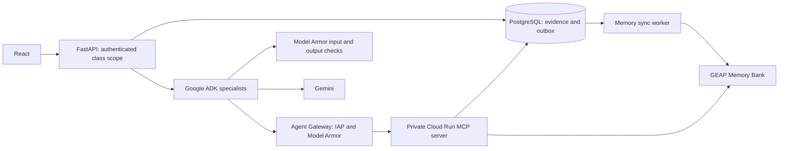

# GEAP governance integration

The code contains managed-service adapters and configuration templates. Cloud SQL and Memory Bank were provisioned earlier; the new **Agent Identity, Gateway, Registry and runtime deployment is not yet applied or verified**. Its deployed workload and registry identifiers are still required. A Gemini API key enables model calls but does not authenticate to Memory Bank, Agent Registry, Model Armor, or provision Agent Identity.

Project is now set to `hackathon-506016`, with `us-central1` as the proposed region. See [project requirements](requirements.md) and [shared Cloud SQL setup](cloud-postgres.md). Run `node scripts/prepare-config.mjs` from the root to render project-specific Gateway configuration without executing a PowerShell script. `bootstrap-gcp.ps1 -Apply` still requires a terminal whose execution policy permits that script and an authenticated gcloud installation; this project does not change your machine's execution policy.

## Architecture

The Gateway arrow is the **target managed deployment**, not a claim that running the local API automatically routes all its traffic through a gateway. GEAP Agent Identity belongs to an agent workload. It does not replace teacher/student login or application-level course authorization.

## 1. Configure and test managed services locally

Install optional packages: `uv sync --extra cloud --python 3.12`. Authenticate using `gcloud auth application-default login` in your own terminal. Managed production workloads use their provided Agent Identity/ADC rather than downloaded service-account keys.

Set `GOOGLE_CLOUD_PROJECT`, `GOOGLE_CLOUD_LOCATION`, `GEAP_MEMORY_BANK_ID` and `GEAP_MEMORY_ENABLED=true`. The Memory Bank ID is the last resource component, not a full resource path. Configure the bank with **custom learning-only memory topics**, excluding general personal information; the service defaults are broader than OpenClass needs. Review memory retention and deletion policies before real learner use.

Every scope is constructed from organization, course and learner IDs on the server. No model-supplied scope is accepted. Approved assessment evidence creates a PostgreSQL outbox item in the same transaction. The worker sends a source-linked summary, retries at most three times, and exposes sync status through `/api/courses/{course}/students/{learner}/memories`. Grade changes update the source summary. GEAP generation can be eventually consistent; a successful sync means the request was accepted, not that a new fact is guaranteed to be extracted. PostgreSQL remains the authoritative grade and evidence store. Remote memory submission is at least once, relying on Memory Bank consolidation; it is not an exactly-once remote write guarantee.

`OPENCLASS_REQUIRE_GOVERNANCE=true` requires configured Memory Bank, Model Armor and Gateway resource names. This config check is not verification of cloud IAM or network enforcement.

## 2. Model Armor

Create a regional Model Armor template with prompt injection/jailbreak screening enabled, plus the desired safety, malicious URL and sensitive-data filters. Set `MODEL_ARMOR_TEMPLATE=projects/PROJECT/locations/REGION/templates/TEMPLATE` and `MODEL_ARMOR_ENABLED=true`.

`backend/cloud/model_armor.py` uses Google's regional SDK endpoint. It checks latest user input, course reference text, source files and retrieved memories before model use, and checks final model output before parsing or saving it. It never sends trusted system policy as user content. Enabled inspection rejects matches, filter failures, service errors and unknown decisions. Protection is layered with read-only tools, schema validation and server authorization; it is not a promise to detect every attack. Configure inline Model Armor on Agent Gateway as well to inspect each model-driven tool request and response. Local adapter screening alone does not inspect every intermediate tool call.

## 3. Separate MCP services

See [MCP service setup](../mcp_servers/README.md): `mcp_servers/data` and `mcp_servers/github` have separate applications, credentials and container images. Both expose `/mcp`; their local ports are 8001 and 8002. `mcp_service` remains a Data-only compatibility import.

Data exposes five scoped academic/memory read tools. GitHub exposes only bounded `inspect_public_repository` through GitHub's official upstream MCP service. Tools cannot publish exams or change grades. Local mode uses an HMAC context secret; managed mode uses API-signed RSA scopes and verified Google Agent Identity tokens with exact SPIFFE subjects. The GitHub scope additionally binds the submitted repository URL.

Build the images with their own Dockerfiles using the repository root as context. Configure actual hosts in `MCP_ALLOWED_HOSTS`. GitHub MCP receives the GitHub token and no DB credential; Data MCP receives a dedicated DB reader and no GitHub token. Deploy with authenticated ingress and exact invoker grants. Never give an MCP server the scope signing private key.

The [managed deployment folder](managed/README.md) contains separate Registry resources and exported tool specifications. Bound tools call fixed configured URLs; Agent Runtime's Gateway configuration and UAP govern routing and access. Transport credentials stay outside model prompts. Registration alone is not enforcement.

## 4. Agent Identity and Gateway

`backend/runtime/Dockerfile` builds the dedicated fixed-specialist runtime adapter. The API Dockerfile serves the web application separately. See [managed deployment](managed/README.md) for seven distinct runtime identities, signed execution grants, default-deny communication rules and the policy renderer. Deployment and actual cloud enforcement remain pending cloud setup and verification. The earlier `runtime.tf.example` is a minimal illustration; use the managed folder for the current structure.

Review and fill `gateway/*.example` for the chosen project and region. The gateway uses IAP `REQUEST_AUTHZ` and Model Armor `CONTENT_AUTHZ`, both fail closed. Grant only the specific agent identity access to the registered MCP destination and required Google resources. Keep Cloud Run's direct invocation restricted so the Gateway cannot be bypassed.

The gateway service agent (`service-PROJECT_NUMBER@gcp-sa-dep.iam.gserviceaccount.com`) needs `roles/modelarmor.calloutUser` and `roles/serviceusage.serviceUsageConsumer` in the gateway project and `roles/modelarmor.user` in the template project. The Agent Runtime service agent may also need documented integration permissions. Review exact resource-scoped IAM and organization policies before applying grants. No broad IAM grant commands are executed by the application.

## Verification before declaring the deployment complete

Test that a wrong learner/course scope is denied; missing, expired and tampered MCP contexts are denied; direct MCP access is denied without authorized workload credentials; the deployed agent has a real Agent Identity; Gateway logs prove traffic routes through the configured gateway; injected prompt/tool content is blocked; a Model Armor outage fails closed; student A cannot retrieve student B's memory; grade updates survive a Memory Bank outage and replay from the outbox. None of these cloud checks has yet been executed in this environment.

Primary references:

- [Memory Bank with ADK](https://docs.cloud.google.com/gemini-enterprise-agent-platform/scale/memory-bank/adk-quickstart)
- [Agent Identity](https://docs.cloud.google.com/iam/docs/auth-agent-own-identity)
- [Configure Agent Gateway](https://docs.cloud.google.com/gemini-enterprise-agent-platform/govern/gateways/set-up-agent-gateway)
- [Runtime Gateway deployment](https://docs.cloud.google.com/gemini-enterprise-agent-platform/scale/runtime/agent-gateway-runtime-deploy)
- [Registry authentication and context headers](https://docs.cloud.google.com/agent-registry/authenticate-toolsets)
- [Model Armor SDK and sanitization](https://docs.cloud.google.com/model-armor/sanitize-prompts-responses)
