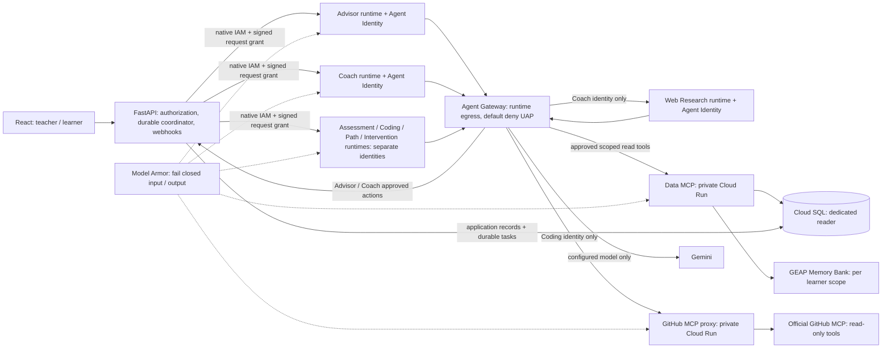

# Managed agent deployment

Status (18 October 2026): **[OpenClass is public and ready to test](https://openclass-jdi6nfaqza-uc.a.run.app)**. All seven specialists are serving on Agent Runtime with distinct identities; both MCP services remain private. Actual endpoints are wired and registered. Five Gateway policies are applied and all seven runtimes are attached. Bootstrap mode is disabled. Public teacher/student login, workspace, notifications and logout pass. Live agent generation, persistence and assessment callbacks have passed; see the [verification record](verification.md) for evidence and remaining checks. Terraform runs through Docker with read-only ADC.

## Release checklist

| Stage | Status |
|---|---|
| Build Linux images and validate full runtime startup | Passed; missing-location negative control also passed |
| Bootstrap application and separate MCP services privately | Ready; teacher/student login, workspace and logout verified |
| Create seven serving Agent Runtime deployments | All seven succeeded |
| Wire actual resource IDs and least-privilege Agent Identity permissions | Applied using distinct actual identities |
| Register destinations, apply UAP rules, then attach Gateway | Registered; five policies applied; all seven runtimes attached |
| Verify agents, memory, assessments, callbacks and access denials | Live core flows passed; protected Web Research passed; full post-attachment matrix and controlled Gateway negative test remain |
| Open the web application publicly | Complete; public frontend and both demo roles verified |

Application-to-Runtime execution is working through the regional mTLS transport. Runtime rejects empty optional environment values, so they are omitted from its deployment specification. Keep `GOOGLE_CLOUD_LOCATION` and omit reserved project/quota overrides. Do not rerun bootstrap release wiring against the live application without reviewing its environment changes: bootstrap mode disables application workers.

## Traffic boundaries



Gateway governs attached runtime egress; it does not host the MCP services or intercept the application's initial Cloud Run-to-Runtime invocation. Agent Registry records URLs/tool specifications and agent endpoints. Agent Runtime hosts one fixed specialist per deployment. Native platform IAM protects invocation; an exact SPIFFE allowlist and signed scopes add application authorization. See [Agent Identity OIDC verification](https://docs.cloud.google.com/iam/docs/auth-agent-own-identity-external), [Runtime custom container contract](https://docs.cloud.google.com/gemini-enterprise-agent-platform/scale/runtime/runtime-contract), [Gateway setup](https://docs.cloud.google.com/gemini-enterprise-agent-platform/govern/gateways/set-up-agent-gateway) and [MCP registration](https://docs.cloud.google.com/agent-registry/register-mcp-servers).

The durable A2A dispatcher/coordinator stays in the API process. It uses the API workload identity to accept queued assessment jobs and deliver authenticated completion webhooks; the model computation can execute in the separate Assessment runtime. Existing task-bound webhook HMAC, terminal payload matching and replay checks remain. The coordinator is not advertised as a deployed LLM agent. Native `/invoke` runtime transport is HTTP JSON, not an A2A service; the existing assessment task interface remains A2A 0.3.

## Deployment order

1. Enable required APIs and confirm preview feature availability/IAM in `hackathon-506016`, `us-central1`. Create Artifact Registry and Secret Manager resources. Preserve the existing Cloud SQL instance. Build three images: `backend/runtime/Dockerfile`, `mcp_servers/data/Dockerfile`, `mcp_servers/github/Dockerfile` using the repository root as build context. The web/API Dockerfile is a separate image.
2. Generate an RSA signing key outside source control. Inject `MCP_SCOPE_PRIVATE_KEY` only into the API; provision its public key to all MCP/runtime workloads. Provide separate GitHub PAT, data-reader DB credentials, application/session DB credentials and Gemini credentials. Do not mount the shared developer `.env` into cloud containers. Use [data-reader.sql](data-reader.sql) for a dedicated read-only DB role. Data MCP currently uses a database connection string; configure private network reachability/TLS or a Cloud SQL proxy sidecar. A local Auth Proxy address does not work in Cloud Run.
3. Create the Gateway and IAP V2 authorization extension/policy using the files in `../gateway/`, replacing project/region. Keep `failOpen:false`; do not use dry-run enforcement. Apply a reviewed Terraform plan in this folder for the separated MCP services, seven runtimes and Registry registrations. The new API workload also needs Agent Identity enabled so its OIDC issuer/subject matches the configured trust domain. Do not use a default Editor service account.
4. Bootstrap in stages: create services/runtimes first; collect actual URLs, registry resource names and Agent Identity subjects; then update environment/maps/registry and exact invoker bindings. `agent_urls` should contain all seven fixed `/invoke` endpoints; `mcp_urls` must end in `/mcp`. For Runtime custom HTTP forwarding use the deployed platform passthrough `/api/invoke` URL described in the Runtime contract. Confirm that custom workload headers are forwarded before enabling the managed API client. Direct Cloud Run hosting of the same specialist image is also supported, but does not constitute Agent Runtime deployment.
5. Populate an inventory JSON with `principals` (alias → actual `spiffe://...` subject), `registered_agents` (alias → actual `projects/.../agents/...`), and `registered_mcp_servers` (`data` / `github` → actual `projects/.../mcpServers/...`). Run `uv run python deployment/managed/render-policy.py --inventory deployment/generated/inventory.json`. It renders exact-principal, exact-tool rules from `security/agent-policy.json`, without changing GCP. The Terraform `workload_principals` map uses equivalent `principal://...` IAM names.
6. Review the generated rules, create the UAP and bind it to the project. The [official UAP guide](https://docs.cloud.google.com/gemini-enterprise-agent-platform/govern/policies/configure-iam-policies-uap) documents the current preview IAM API and CEL attributes:

```powershell
gcloud iam access-policies create openclass-agent-access --details-rules=deployment/generated/openclass-uap-rules.json --project=hackathon-506016 --location=global
gcloud iam policy-bindings create openclass-agent-access --policy=projects/hackathon-506016/locations/global/accessPolicies/openclass-agent-access --target-resource=//cloudresourcemanager.googleapis.com/projects/hackathon-506016 --project=hackathon-506016 --location=global
```

7. Grant each workload only its required Secret Manager versions, Armor template invocation, Memory Bank operations, database/network access and Runtime invocation permissions. The Terraform templates deliberately do not grant project-wide resource invocation or secret access. Check inherited IAM/UAP grants too: an extra broad allow can defeat a narrow allowlist. Runtime access to Google APIs (Gemini, Armor, Memory and session storage) needs reviewed registered API endpoint rules; the generated policy covers OpenClass agents/tools only and intentionally does not allow arbitrary internet destinations. The GitHub proxy's upstream access is server-side and separately controlled. Web grounding is a built-in model capability, not a general URL-fetching tool.
8. Create/review the Model Armor template using `../model-armor-template.json`, enable prompt-injection/jailbreak/malicious-URL filters and verify both clean and blocked requests. Application input/output checks fail closed on blocked, partial, unavailable or timed-out inspection. Optional Gateway Armor extension files are an additional protection; verify their current preview schema before applying. Application checks are still required for traffic outside MCP.
9. Set managed configuration only after dependencies and policies work: `OPENCLASS_GOVERNANCE_MODE=managed`, `OPENCLASS_AGENT_EXECUTION=managed`, `OPENCLASS_REQUIRE_GOVERNANCE=true`, both MCP flags, Memory/Armor flags and resource names, pinned STS issuer, common workload token audience, exact workload principal map, agent URLs and scope public key. API additionally receives the scope private key. MCP processes receive only public verification keys. Bind the correct per-service `DATA_MCP_AUDIENCE` / `GITHUB_MCP_AUDIENCE`. Standard Cloud Run MCP transport opts out of token certificate binding per ingress request; the separate application token verifies the SPIFFE subject. Runtime transport uses Google's authorized session with mTLS support.

Terraform formatting and provider schema validation passed in Docker using Terraform 1.13 and `hashicorp/google-beta` 8.7.0; the provider lockfile is included. Authenticated bootstrap plans have been applied; that does not establish end-to-end application readiness. Inspect a fresh plan before each deployment stage. When validating in Docker, mount the repository root and use `/work/deployment/managed` as the working directory so the shared policy file is available. Runtime identity resources cannot be retrofitted safely by merely renaming an existing shared runtime. Enable identities when creating the separate deployments.

## Wiring deployed resources

After all seven runtimes and three Cloud Run services exist, `wire-release.py` reads Terraform outputs and validates actual resource names, distinct workload identities and HTTPS service origins. It refuses incomplete bootstrap resources. Run it without arguments to validate, then with `--apply` to update the ignored release values. It enables registration and exact invocation bindings in the next Terraform plan, while preserving application bootstrap mode. It does not apply Terraform, open public access or enable background workers. Gateway UAP rules and live acceptance checks remain separate release steps.

After Registry creation, `wire-release.py --policy` validates and renders the Gateway policy; add `--apply` to prepare those rules in the next Terraform plan. The renderer also includes exact-host/path/method routes for the configured Gemini model, regional Armor sanitization and the pinned issuer's public verification keys. No arbitrary URL or external repository fetching is granted to specialist runtimes. Actual Gateway matching, including gRPC sanitization requests, must pass live checks before release.

Runtime project and quota-project overrides are excluded because the platform reserves them. `GOOGLE_CLOUD_LOCATION` is allowed and explicitly retained, as in the installed Google deployment template; OpenClass requires it during startup. Cloud Run services receive their configured project context.

`enable_gateway_attachment` remains false during private runtime bootstrap. Enforcing Gateway attachment must follow actual identity collection, required platform-route grants and installation of the Gateway CA in the runtime image. The image builder retrieves the public CA from the configured Gateway and installs it for Python/OpenSSL/gRPC; it never disables TLS verification. Set attachment true only after reviewing the complete Gateway policy. Native IAM plus payload-bound request grants remain required for agent invocation during bootstrap.

Cloud Run native Agent Identity resolves injected secrets as the agent principal, rather than the configured platform service account. `bootstrap/web-access.tf` grants only the five application secrets and Cloud SQL connectivity to the actual identity observed on its created revision. Service-template output may omit identity: the wiring helper reads it from the actual revision and normalizes Google's `//trust-domain/resources/...` format.

## Required acceptance tests

Before opening the managed UI, prove: valid Coach → Data and Coding → GitHub succeed; Web → Data and unknown agent → any protected endpoint fail; forged/expired token and wrong audience fail; a student cannot read another student; a GitHub capability cannot change repository URL; changed execution payload fails; disabled/unavailable Armor blocks generation; ten assessment jobs complete through durable tasks/webhooks and survive API restart. Attempt direct endpoint calls as well as gateway calls to detect bypasses. Confirm audit logs show distinct subjects. Local tests cover the application decisions; they do not prove cloud policy enforcement.
