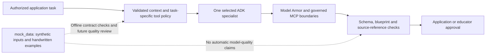

# Agent architecture review

> Historical review of the earlier LLM-only architecture. The current implementation uses six dynamic ADK workflows, scoped learner and teacher tools, assessment delegation and notifications. See [the current workflow design and validation limits](dynamic-workflows.md). Findings below describe the earlier baseline; they are not a current inventory.

Reviewed against the current source, not against a live cloud deployment.

## Current responsibilities

| Specialist | Entry point | Inputs | Output | State-changing authority |
| --- | --- | --- | --- | --- |
| Teacher | Course chat for an educator | Curriculum, class Twins, recent private conversation | Text inside a `message` envelope | None |
| Tutor | Course chat for a learner | Curriculum, own Twin, private conversation, optional GEAP memory | Text inside a `message` envelope | None; application stores the conversation |
| Assessment | Exam-generation background task | Course, validated blueprint, optional selected learner Twin | Pydantic `ExamOutput` | None; application validates constraints and stores a draft |
| Intervention | Educator requests a learner plan | Course and selected learner Twin | Pydantic `InterventionOutput` | None; educator explicitly assigns the draft |
| Coding | Repository-review endpoint | Concept list and bounded read-only source sample | Pydantic `CodeOutput` | None; report requires review and does not update mastery |

FastAPI is the deterministic orchestrator. `runner.py` builds one ADK agent per invocation, applies the common policy, runs input/output inspection when enabled, validates structured output and bounds execution time. There is no autonomous root agent, agent-to-agent delegation, dedicated grading agent or separate diagnosis agent. Objective grading and Twin aggregation are ordinary Python business logic. That separation is useful: models propose learning content while application code controls grades, permissions and publication.

## Findings and priorities

| Priority | Finding | Recommended change / validation |
| --- | --- | --- |
| High | Model Armor checks selected context fields, but not every untrusted curriculum string; tool-call inspection depends on deployed Gateway policy | Enumerate untrusted inputs such as names, objectives, concept text and material titles; inspect them at appropriate boundaries and test malicious text in each. Verify inline Gateway coverage before relying on it. |
| High | Registry discovery attaches the same registered toolset to any text agent with a context token; actual teacher chat currently receives no token | Filter tools per specialist and task. In particular, a tutor should not receive repository inspection merely because it shares an MCP server. Keep signed learner scope outside model context. |
| High | Agent Identity and Gateway runtime enforcement are deployment targets; five Python specialists do not imply five independently governed cloud identities | Decide whether to use one governed workload identity with task-scoped tool permissions or multiple deployments with separate identities. Verify resource IDs and Gateway traffic rather than relying on config presence. |
| Medium | Only tutor chat retrieves managed memories; assessment and intervention requests use the deterministic Twin | Keep evidence authoritative, and explicitly define which learning preferences should also be retrieved for each specialist. Do not treat generated memory as a score. |
| Medium | Teacher/tutor outputs are text; coding references and intervention evidence citations are not fully checked for semantic correctness | Add citation validation against supplied evidence/files and mark unverifiable claims for review. Schema validation alone cannot prove correctness. |
| Medium | A timeout applies to the whole call; several sequential Model Armor checks compete with model latency inside that budget | Measure stage timings and provide separate bounded inspection/model budgets. Do not disable inspection to meet latency targets. |
| Medium | Agent definitions are instantiated per call; conversation sessions now persist in PostgreSQL using organization/course/actor/specialist IDs | This change adds cross-request continuity. Add retention/compaction, correlated invocation IDs and token/cost accounting. Current latency logs do not establish full observability. |
| Medium | Generation uses process-local tasks and limits | Move long jobs and quotas to durable/distributed infrastructure before scaling the API across instances. |
| Medium | Prompt injection, answer-key correctness, factuality and fairness have not been established by live quality evaluation | Use versioned scenarios and human-reviewed rubric evaluation separately from deterministic tests. Mock outputs are examples, not passing model results. |

This review documents changes to prioritize; it does not claim those changes are already implemented. It does not change prompts, models, cloud permissions or running services.

## Proposed next architecture step

Retain deterministic application orchestration. Add explicit request contracts, specialist tool allowlists, source-reference validation and correlated execution metadata. Deploy a managed runtime only after its invocation and authorization paths are tested. Avoid adding autonomous delegation until a workflow actually needs it.

The proposed tool-policy and source-reference checks go beyond the present implementation. The mock cases deliberately include no evidence, sparse perfect evidence, prerequisite gaps and theory/practice differences so these boundaries can be reviewed concretely.
