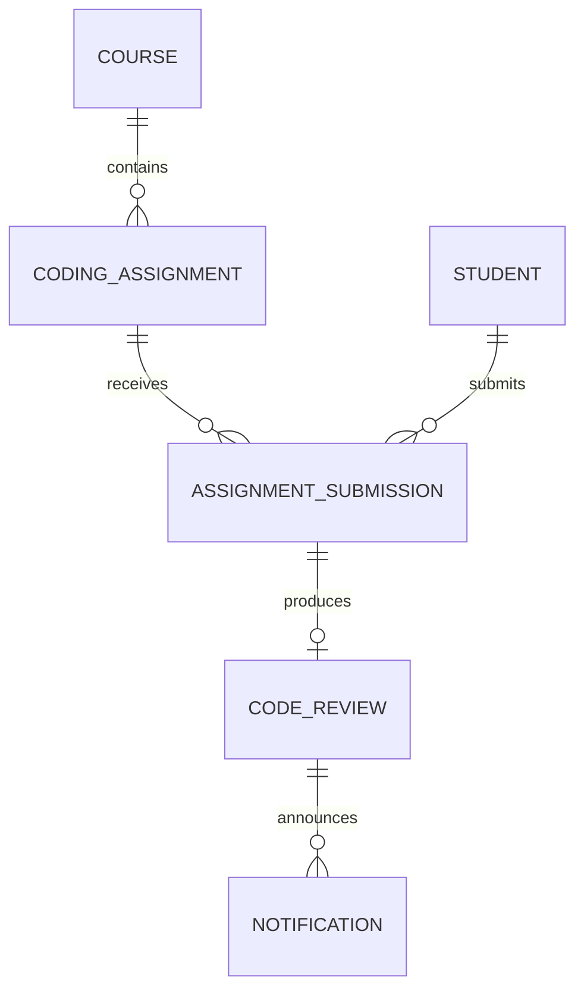
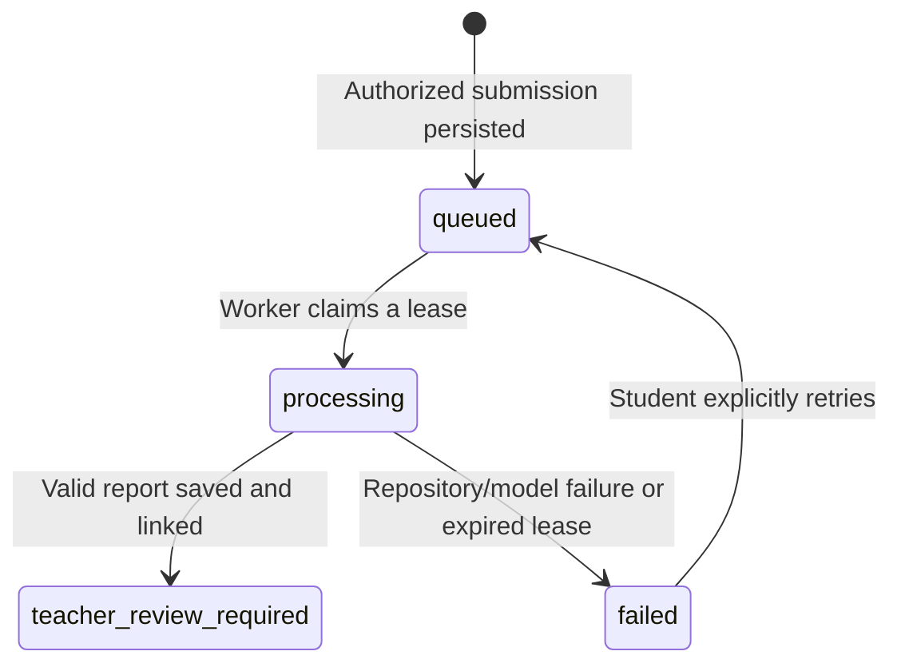

# Assignment and submission data model

Coding assignments use the application's existing Cloud SQL PostgreSQL `records` table. Record `kind` identifies each entity and `data` stores its JSON payload. `AssignmentRecord` and `SubmissionRecord` in [`backend/assignments.py`](../backend/assignments.py) validate newly written records, including lifecycle states and schema version. This adds structured entities without replacing existing fixtures or requiring a destructive database migration.

| Entity / record kind | Stored fields |
| --- | --- |
| Assignment / `coding_assignment` | ID, organization, course, teacher, title, instructions, concept IDs, selected student IDs (empty means class-wide), published status, creation timestamp, schema version |
| Submission / `assignment_submission` | ID, assignment, organization, course, student, repository URL, attempt number, status, creation/update timestamps, processing lease, safe error message, linked review ID, schema version |
| Report / `code_review` | ID, submission ID, assignment ID, course, student, repository URL, structured Coding Agent report, static inspection scope, teacher-review status, creation timestamp |

Older assignment and report fixtures remain readable; their newer metadata and submission references may be absent. References are enforced by application authorization and validation; this existing JSON record store does not provide relational foreign keys between these entities. Repository URLs are stored, not a full clone or code archive.

## Submission lifecycle

`POST /api/courses/{course_id}/coding-submissions` returns HTTP 202 after persistence. It does not wait for GitHub fetching or Gemini. Repeating the same submission while its assignment review is active returns the existing record; submitting a different repository during that review returns 409. New submissions after a terminal outcome receive a new attempt number. Retry reuses a failed submission via `POST /api/coding-submissions/{id}/retry` and is restricted to its owner.

The background worker claims rows using PostgreSQL `FOR UPDATE SKIP LOCKED`, releases the transaction before network/model work, and stores completion and notifications in one transaction. One review worker runs per API process. A ten-minute lease lets an interrupted review become a visible failure after a restart; it does not automatically repeat model spend. Completion verifies the lease before writing, uses a deterministic report ID and avoids duplicate completion notifications. The backend must remain running to process queued reviews.

`GET /api/courses/{course_id}/coding-assignments` returns assignment definitions, saved reports and `tracked_submissions`. Teachers see submissions in their class; students see their own. The UI polls every five seconds while visible, displays tracking IDs and status, and provides retry for failures. Both student and teacher receive report-ready notifications. Coach context includes the student's saved submission statuses as well as reports.

Coding Agent ratings are provisional static-source estimates. This lifecycle does not publish final grades, run submitted code or automatically update mastery evidence.
