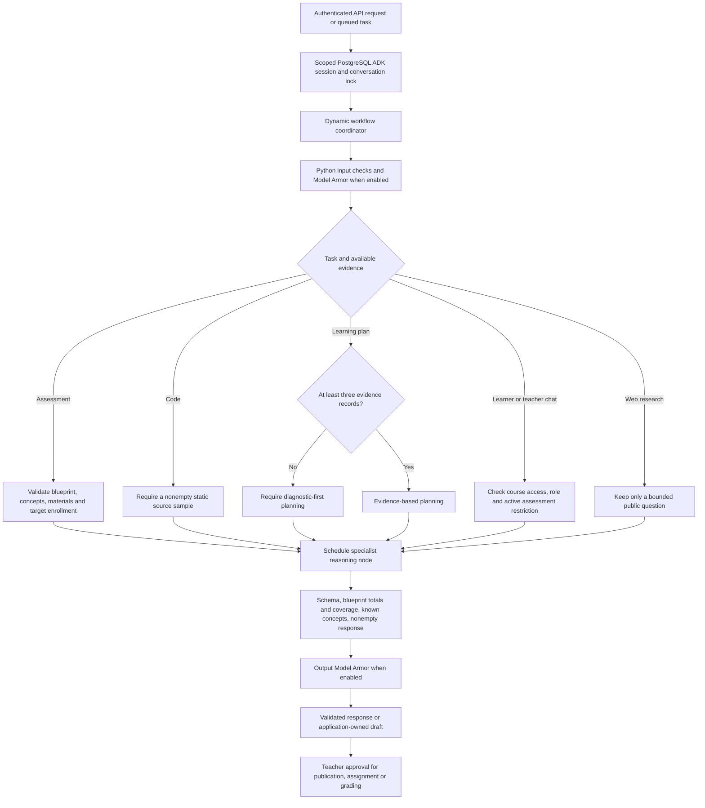

# Dynamic agent workflows

Assessment delegation now uses durable A2A tasks, authenticated completion webhooks and bounded batch workers. See [the current A2A flow](a2a-workflows.md). Exact progress-summary and standard scheduling shortcuts are Python workflow branches. Interactive Coach/Advisor turns use temporary graph checkpoints by default, while final conversation records/session IDs stay in PostgreSQL. Full interactive ADK checkpoints are opt-in; long-running assessment reasoning retains durable ADK sessions.

All six agent entry points are ADK 2.x `Workflow` objects. Each specialist folder has `workflow.py` for construction, `agent.py` for its reasoning instructions and schema, and (where needed) `tools.py` for scoped capabilities. Shared scheduling and checks live in `backend/agents/workflow.py`; session handling remains in `sessions.py` and `runner.py`.

The coordinator uses `@node(rerun_on_resume=True)` and `await ctx.run_node(...)`, following the [ADK dynamic workflow API](https://adk.dev/graphs/dynamic/). LLM agents remain internal reasoning nodes. Input gates and output validators execute as Python nodes. Failed checks raise an error and prevent downstream execution. Workflow retries are disabled to avoid repeating tool-triggered jobs.



| Workflow | Deterministic controls | Reasoning and tools |
| --- | --- | --- |
| Assessment Generator | Blueprint schema, enrolled target, known concepts, material availability; output count, marks, format and coverage | Gemini drafts questions; application saves a reviewable draft |
| Coding Agent | Nonempty supported source sample; output schema and rating bounds | Static inspection only; no repository execution or automatic grades |
| Learning Coach | Course/learner scope, active assessment pause, nonempty response | Own progress, own GEAP memories and isolated public research tool |
| Classroom Advisor | Teacher/course scope, tool-level learner authorization, explicit test-generation intent | Student academic details and GEAP memories; targeted draft request to assessment coordinator |
| Intervention Planner | Evidence-count branch, known output concept, schema | Diagnostic-first plan when evidence is sparse; otherwise evidence-based support |
| Web Research | Only public question sent, length bounds, nonempty response | Google Search grounding, isolated from student records; caller checks query for private identifiers |

The three-record diagnostic threshold is a conservative routing heuristic, not a calibrated confidence estimate. Chat and search return ADK Content, explicitly converted and checked by the workflow; assessment, code and intervention return Pydantic-validated objects. Shape checks cannot establish factual correctness or answer-key quality.

Teacher test requests follow `Classroom Advisor → scoped request_student_test tool → deterministic job coordinator → Assessment Generator workflow → draft ready notification`. Only a teacher can publish. Notifications also cover submissions, coding reports, assigned plans and memory-sync outcomes. The notification bell polls every eight seconds; popups appear for new unread events while the application is open.

Student names open a detailed academic profile with concept evidence, attempts, coding reports, learning plans, Twin history and memory-sync information. A teacher can choose that learner as the Advisor's context. Private learner chat transcripts are not included.

GEAP Memory Bank supplies scoped long-term learning context; PostgreSQL evidence remains authoritative for mastery. Model Armor inspects selected inputs and validated outputs when configured. Agent Identity, Gateway and MCP resource configuration still require deployment and enforcement verification; constructing a workflow does not enable those cloud services.

From a terminal with working Python:

```powershell
uv sync --extra cloud --group dev
uv run pytest tests/test_dynamic_agents.py tests/test_learning.py -q
```

`test_dynamic_agents.py` uses an in-memory ADK runner and fake reasoning node to check scheduling, input rejection and output rejection without cloud services. `test_a2a.py` adds protocol, callback replay, ten-task concurrency and deterministic summary checks. Assessment jobs now use a PostgreSQL queue with leases, plus a callback outbox; workers still require a running service with CPU outside request handling. Live Gemini, managed-memory and Gateway behavior need separate integration validation.
