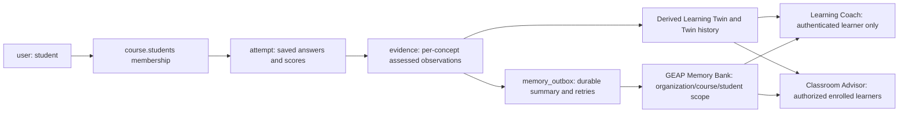

# Student persistence and chat context

PostgreSQL stores student data today. This version uses a generic `records` table with `id`, `kind`, JSON text `data`, and insertion `sequence`. It does **not** yet have separate relational `students`, `enrollments`, or `grades` tables or foreign-key enforcement between record payloads. Application services validate those relationships.

| Record kind | Student-related data |
| --- | --- |
| `user` | Account ID, name, email, organization, role and salted password hash. Students have `role=student`. Password hashes never enter agent context. |
| `course` | Teacher ID and enrolled student IDs, plus concepts, objectives and materials. Enrollment is the course's `students` array. |
| `exam` | Questions, blueprint, publication status and optional selected/assigned student IDs. |
| `attempt` | Student/course/exam IDs, saved answers, timing, status and reviewed/objective scores. |
| `evidence` | Student/course/concept IDs, assessed score, confidence, source and source ID. Missing observations remain unknown. |
| `twin_history` | Source-linked snapshots of evidence-based learning state. The current Twin is derived from evidence. |
| `code_review` | Student's repository reference and provisional static-analysis report. |
| `intervention` | Draft/assigned learning support plan and selected student ID. |
| `chat` | Actor/course IDs, question, response, tool actions and sources. A teacher's learner discussion belongs to the teacher's conversation. |
| `memory_outbox` | Student/course/organization scope, assessed summary, source ID, retry count and synchronization status. |
| `notification` | Recipient, course, task event, target and read status. |
| `job` / `assessment_batch` | Teacher-owned generation requests, explicit recipients, blueprints and per-learner progress. |
| `a2a_task` / `a2a_delivery` | SDK task snapshot, generation lease and authenticated callback outbox. These private service records are not exposed through student APIs. |

Authentication sessions live in the public `sessions` table; ADK conversation sessions/events use the separate `openclass_adk` schema. These are distinct from long-term GEAP Memory Bank memories.

Interactive Coach/Advisor workflows keep a server-derived session ID and final chat history in PostgreSQL, with temporary graph checkpoints by default. Set `ADK_PERSIST_INTERACTIVE_CHECKPOINTS=true` for full per-node SQL checkpoints when needed. Delegated A2A tasks and non-interactive assessment reasoning remain durable. Recent stored chat turns are explicitly supplied on subsequent interactive requests.



The starter database seed enrolls 30 students but adds synthetic baseline evidence for only the first six, including Jamie Chen (`student-1`). Therefore an untouched starter classroom has **24 learners without evidence**. This is intentional demo coverage, not a failed assessment import or 24 low scores. The richer optional `mock_data/` fixtures are separate from the initial database seed; adding files does not overwrite a populated database. Actual counts change when students submit assessments or fixtures are imported.

The Advisor resolves a uniquely mentioned full learner name within the authorized roster, or uses the explicit learner selector. It gets compact class summaries and the selected learner's academic details. The Coach gets only the authenticated student's Twin and recent conversation. Both use bounded, course-scoped memory lookups and clearly distinguish disabled/unavailable memory from an empty search result. Memory retrieval success does not prove a previous memory write succeeded.

Only assessed summaries enter the automatic memory outbox. Ordinary chat transcripts are stored in PostgreSQL, not automatically copied into Memory Bank. Passing a message to the Coach does not by itself create a long-term memory.

Workspace pages use URLs such as `/courses/python-foundations/students` and `/courses/python-foundations/tutor`. Reload and browser back/forward restore the page and course. The combined production server serves the React entry point for deep links while preserving missing asset and API errors. A timed exam still resumes through the Assessments page.

Validation:

```powershell
node --test frontend/src/navigation.test.mjs
uv run pytest tests/test_chat_improvements.py tests/test_dynamic_agents.py tests/test_learning.py -q
```

The Python regression tests cover one evidence read per class, name resolution, learner-only context, active-assessment restrictions, explicit memory fallback and Model Armor rejection. Live Gemini, Cloud SQL and Memory Bank access require separate runtime verification.
